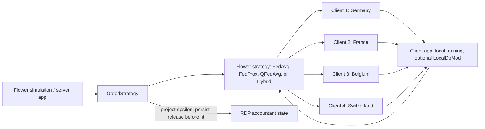

# Repository diagnosis — 2026-11-21

## Scope and repository identity

This diagnosis uses the local checkout only; no remote repository state was inspected. The checkout is `feat/task0-baseline-federation` at `c6ef41ba4a4710b8f1c281aca3f577d2884ddad5`. It was already dirty at the start of this continuation. The edits recorded below remain uncommitted and unstaged.

The repository has Python package code under `src/insurance_fl/`, unit and integration tests under `tests/`, runnable notebooks under `notebooks/`, and engineering decisions/evidence under `docs/`. Flower app wiring is in `src/insurance_fl/fl/{server_app,client_app,strategy,privacy,task}.py`; CI is defined in `.github/workflows/ci.yml` and local entry points are in `Makefile`.

## Verified execution model

The local Flower simulation configures four supernodes backed by four synthetic partitions. The clean-HOME `make flwr-guard` run completed one fit and evaluation round and proved four distinct partition mappings, four fit identities, and four evaluation identities. The reported `client_id` is a simulation identity signal; it is not authenticated deployment identity. SecAgg+ orchestration remains fail-closed in `server_app.main`.

## Stage-by-stage status

| Stage | Current status | Evidence and remaining work |
|---|---|---|
| 0 — Baseline audit | PARTIALLY_VERIFIED | Local checkout, project structure, current CI definition, tests, and run configuration inspected. No remote state inspected. A complete inventory of every module/notebook and all historical artifacts remains open. |
| A — Data and ML validation | VERIFIED_FOR_SYNTHETIC_DATA | Final `make data-check` passes: 4 × 5,000 rows, label logic hash `03051d931c560108`, logical data hash `0f0f5df8143c7b5c297c4565583f64f236fe63d2c9eea22d45a998a2cbe628c0`. xgboost 2.1.4 smoke passed; cross-version parity is blocked pending Linux x86_64 baseline predictions. |
| B — Four-client server architecture | VERIFIED_FOR_LOCAL_SIMULATION | Final clean-HOME `make flwr-guard` passes: four distinct mappings, four fit and four evaluate identities. Client identity is simulation-only. FedBN invariance, malformed update, identity-source and dropout tests pass; production authentication remains Stage F. |
| C — Privacy gate and restart safety | VERIFIED_FOR_PRIVACY_STATE_AND_GATE | Gate wraps all four strategies, checks before fit dispatch, persists state before dispatch and audits refusal once. Four negative-control mutations each failed and were restored. Gate/noise test set: 29 passed. C6 trained 2/5 rounds then refused 3; resume restored `rounds_spent=2` and refused further fits. Model-weight checkpoint resume is not shown. |
| D — MIA and DP evaluation | VERIFIED_FOR_SYNTHETIC_MEASUREMENTS | Bootstrap control is 250/250, AUC 0.6503 (95% CI [0.6003,0.7004]): pre-registered lower bound >0.55 passes; target AUC ≥0.75 does not. Ordinary v2 four-client MIA intervals include chance and do not prove zero leakage. DP utility curve is regenerated with the LocalDpMod helper/accountant multiplier; severe utility loss is measured. |
| E — Fairness, calibration, causal/transportability | VERIFIED_FOR_DOCUMENTED_EVIDENCE | Fairness remains `inconclusive`: Bayes proxy spread 0.0290, federated spread 0.0347, descriptive excess 0.0057, not a causal attribution. Raw calibration remains default; 24 model inputs vs 26 numeric columns are clarified. Notebook light validator passes 19/19. Predictive and causal transportability remain separately described. |
| F — TLS and communication security | LOCALLY_VERIFIED_API_SCOPE | Flower 1.31 TLS root validation, wrong CA/expiry/hostname negatives, registered-key/node binding, unauthorized-node rejection and no-plaintext-fallback tests pass. Deployment SuperNode auth is unverified because simulation cannot exercise it; SecAgg+ orchestration is blocked by the fail-closed server path. |
| G — Containers | IMPLEMENTED_BUT_UNVERIFIED | Added pinned Flower 1.31 Dockerfile/Compose topology with one SuperLink, four partitioned SuperNodes, one server app, four client apps and synthetic data initializer. `docker compose config --quiet` and service inventory pass. Docker/Compose installed and daemon is running; full image build and four-client run are unverified because host disk has only 122 MiB free. `which podman` is empty. |
| H — CI/CD and supply chain | IMPLEMENTED_BUT_UNVERIFIED | Added `container.yml` for PR/push, weekly scheduled and release builds with pip consistency and pinned Trivy image scan. YAML parses locally; no GitHub runner executed it. Existing CI remote failures and local runtime lock audit remain as recorded above. |
| I — Reproducibility and governance | LOCALLY_VERIFIED_WITH_LIMITATIONS | Canonical manifest, logical content hashes, provenance checks, deterministic model weights, and local clean source snapshot audit/provenance tests pass. No remote Git clone or model-checkpoint resume is claimed. |
| J — Cloud/distributed deployment | IMPLEMENTED_AS_PROVIDER_NEUTRAL_DOCUMENTATION | `docs/DEPLOYMENT.md` states organization-separated data/runtime boundaries, identity/TLS, operations and limitations. No provider deployment or multi-organization validation has occurred. |
| K — Auditability and governance | LOCALLY_VERIFIED_WITH_LIMITATIONS | Persisted redacted events have verifiable hashes; tests cover ordering, secret redaction, restart read continuity and payload tampering. Hashes are not tamper-proof against a writer who can recompute them; retention remains an operational policy, not automatic deletion. |

## Measurements from this continuation

- Focused privacy gate and server app tests: **31 passed** after gate and resume wiring.
- Non-slow unit suite before gate negative-control additions: **297 passed, 4 deselected (301 collected)**. After Task 1: **299 passed, 4 deselected (303 collected)**. The successful run was outside the sandbox because a generator child process aborted when OpenMP could not create shared memory inside the sandbox; Task 1's two new tests account for the collection increase.
- Slow unit suite: **4 passed, 294 deselected**, outside the sandbox for the same child-process shared-memory issue.
- Integration suite: **47 passed**, outside the sandbox after the TLS/OpenSSL child process aborted in the sandbox.
- Privacy-invariants commands from CI: privacy/artifact unit tests **29 passed**; accounting integration tests **16 passed**.
- Ruff: passed. Black: 105 files unchanged. Isort: passed after import ordering fixes. Mypy: success on 46 source files.
- `make data-check`: passed.
- Clean-HOME `make flwr-guard`: passed, `Run finished 1 round(s)` and `flwr-guard identity checks: OK (4 mappings, 4 fit, 4 evaluate)`.
- `NB_MODE=light` notebook validator: **11/11 notebook executions passed** with the repo venv and Flower 1.31. The process returned failure only because its final source-unchanged guard sees notebook diffs that were present in the initial worktree. The validator was not edited and notebook diffs were preserved.
- `python -m pip check`: fails because the active macOS venv has xgboost 1.7.6 while project metadata requires xgboost 2.x. It is an environment mismatch, not a passing quality result.
- **Superseded by the environment task:** active macOS arm64 venv now has xgboost 2.1.4; `pip check` is clean and `tests/unit/fl/test_boosters.py` passes (1 passed). Runtime Linux lock pins 2.1.4. D-XGB-002 comparator evidence confirms the reported GBM is sklearn `HistGradientBoostingClassifier`; xgboost is only in the booster stacker path. Cross-version stacker parity remains blocked because the accepted comparison environment is Linux x86_64 and no old-version xgboost per-client predictions/AUCs are recorded. See D-XGB-003.
- `git diff --check`: reported one existing trailing blank line in `docs/DECISIONS.md`; clean this before claiming whitespace validation.

Task 1 gate mutation evidence was completed after the initial diagnosis: each enforcement mutation caused its targeted assertion to fail, each mutation was restored immediately, and the restored gate plus noise-calibration set passed (**29 passed**). Raw captured pytest outputs are in `docs/evidence/privacy_gate_reverts_2026-11-21/`.

## Privacy-gate and C6 evidence

`GatedStrategy` is composition-based. `build_strategy` consumes gate-only arguments before constructing Flower strategies, so stock constructors do not receive `max_epsilon` or the state path. With privacy disabled, the wrapper delegates without refusing. With privacy enabled, it calls `project_epsilon(additional_releases=1)`, returns `[]` if the budget would be exceeded, and otherwise accounts and saves before dispatch.

The C6 run in `docs/evidence/c6_run_2026-11-21/` used synthetic smoke partitions (`data/processed/fl_task0_smoke`), five configured rounds, clip norm 1, noise standard deviation 1, delta `1e-5`, and epsilon cap 8. It spent two releases; at the next release it had spent epsilon 7.0774 and projected epsilon 9.0100. The resume run used `privacy-resume=true`, restored round 2, spent no additional releases, and kept `rounds_spent=2`. This validates the privacy accountant/gate path on a local synthetic simulation, not model-weight restart or production DP deployment.

## MIA sample-count correction

`scripts/run_mia.py` hard-coded 32 examples per class in the overfit target and shadow controls, even when larger counts were requested. The cap is removed; target and shadow counts now use requested sizes bounded by available rows. The positive control trains a wider single-task model with no dropout or batch normalization, no weight decay, and no early stopping; its input scaling is fit on training rows only.

The generated `reports/mia_evaluation.json` is explicitly a synthetic overfit control with 250 members and 250 nonmembers. The groups are disjoint. ROC AUC is 0.650336, bootstrap 95% CI is [0.600336, 0.700396], `1 - AUC` is 0.349664, and nonmember-minus-member mean loss is 2.43753. The CI lower bound is above the pre-registered 0.55 control threshold. The worktree is dirty, recorded as `git_dirty=true`; this empirical control is not a privacy guarantee and does not replace the ordinary v2 attack evaluation.

## Risks and blockers

1. Remote Linux CI/security status is not green in the latest recorded workflow; local macOS dependency state differs from declared constraints.
2. The xgboost environment mismatch is resolved locally (2.1.4; clean `pip check`). Cross-version parity remains blocked pending Linux x86_64 evidence (D-XGB-003).
3. The notebook validator executed every notebook, but its no-diff exit guard cannot distinguish edits that predated the run from edits made by the validator. The recorded 11/11 execution result is valid; the command-level guard remains unresolved without a clean comparison checkout.
4. The C6 evidence uses a synthetic smoke dataset and does not restore model parameters on resume.
5. SecAgg+ end-to-end Flower app orchestration remains fail-closed; local simulation identity is not authentication.
6. `reports/dp_utility_curve.json`, the ordinary MIA evaluation, the four enforcement revert demonstrations, and complete notebook modernization are still open.
7. The requested TaskCreate task-list tool is not available in this session. This diagnosis and `IMPLEMENTATION_STATUS.md` hold the resumable task record instead.

## Prioritized roadmap

1. Re-run final non-slow/slow unit, integration, privacy-invariants, `make data-check`, clean-HOME `make flwr-guard`, and notebook validation after the latest changes; resolve the notebook unchanged-guard evidence without replacing the user's existing diffs.
2. Broaden release-ordering and resume-continuity negative coverage. The four gate mutation demonstrations and 20,000-sample LocalDpMod noise calibration now pass.
3. Run ordinary v2 MIA and DP utility evaluations with full provenance; keep the positive control separate from empirical privacy claims.
4. Diagnose the approximately 10-million round-1 loss by task and target scale; make a fix only if a failing assertion demonstrates it.
5. Complete fairness/calibration/feature-surface wording checks, xgboost parity on a compatible Linux environment, and evidence hygiene.
6. Verify Flower 1.31 TLS authentication/authorization behavior, then resolve or formally block SecAgg+ end-to-end orchestration.
7. Complete FedBN/isolation negative tests, audit continuity/redaction/integrity tests, and clean-clone reproducibility.
8. Add container/cloud infrastructure only after privacy and federation evidence is stable; mark any runner-dependent result unverified until the runner reports success.

## Verified continuation update — 2026-11-21 (environment drift)

- Environment alignment: xgboost 2.1.4 installed in the current macOS arm64 venv, matching project metadata and the runtime Linux lock. `pip check`: no broken requirements. Booster smoke test: 1 passed.
- D-XGB-002 comparator evidence: `scripts/eval_is_high_risk.py` defines its GBM using sklearn `HistGradientBoostingClassifier`; `boosters.py` calls xgboost in the separate stacking pipeline. The four stored GBM AUCs are not xgboost parity measurements.
- Parity remains BLOCKED pending Linux x86_64: current host architecture is arm64 and there are no captured xgboost 1.7.6 stacker outputs to compare with 2.1.4. D-XGB-003 records the decision.
- Post-task regressions: non-slow 299 passed/4 deselected (303 collected); slow 4 passed/299 deselected (303 collected); integration 47 passed. The two additional gate tests explain the increase from the earlier 301 non-slow and 298 slow collection totals.
- Next exact action after security: fix and verify the notebook validator guard using before/after hashes, then add its unchanged-pass / changed-during-run-fail tests.

## Verified continuation update — 2026-11-21 (security audit)

- Linux runtime lock pip-audit found 34 records / 27 unique IDs across cryptography 46.0.7, pyarrow 17.0.0, torch 2.4.1, and uv 0.11.33. The TOML checker reports all 27 runtime IDs covered and no stale IDs. It reports 56 unignored full-lock IDs as report-only warnings. No uncovered runtime IDs remain, so no additional per-ID ignore decision was needed. Six ignore-checker tests passed.
- Gitleaks 8.30.1 scans of `src`, `tests`, `scripts`, and `docs` found no leaks. Three generic-key matches from a whole-worktree scan were confined to minified vendored Jupyter assets in `venv`.
- Latest recorded CI: run 44704520949 failed the artifacts `make flwr-guard` step (`num-partitions=10` vs expected 4); run 44609880224's security step used the old CI lock/plaintext ignore path and found ray 2.55.1 / PYSEC-2026-2273 twice. Exact captured logs and the audit report are under `docs/evidence/security_audit_2026-11-21/`.
- Post-security regression totals remain 303 collected per unit marker selection (non-slow: 299 passed/4 deselected; slow: 4 passed/299 deselected); integration 47 passed.
- The notebook validator guard now compares SHA-256 notebook hashes from immediately before and after execution. Its two guard tests pass (unchanged sources pass; modified source is detected). `NB_MODE=light ./venv/bin/python scripts/validate_notebooks.py` exited 0 with 11/11 notebooks passed, despite pre-existing dirty notebook files. Post-task totals are 305 unit collected (301 non-slow passed/4 deselected; 4 slow passed/301 deselected) and 47 integration passed.
- Next exact action: correct 250/250 MIA interval labeling, run the ordinary v2 four-client MIA with provenance and power statement, and regenerate `reports/dp_utility_curve.json` with `dp_sweep.py` and the accountant multiplier.

## Verified continuation update — 2026-11-21 (MIA and DP artifacts)

- Control interval is percentile bootstrap (1,000 resamples, fixed scores), not analytic. AUC 0.650336, 95% CI [0.600336, 0.700396]. Pre-registered lower bound >0.55 passes; master-prompt AUC ≥0.75 fails. Fields are derived from the regenerated run.
- The MIA script had labeled nonmember held-out rows as members in ordinary mode. Corrected it so target and shadow members come from train rows and nonmembers from held-out rows; a unit test checks the split origin and disjointness. Ordinary attack target uses the recorded in-process FedAvg+FedBN reference, per-client local BN.
- Ordinary v2 MIA: 500 members / 500 nonmembers / 1,000 bootstrap resamples per client. Germany AUC 0.4995 (CI 0.4632–0.5369), TPR@1%FPR 0.0082; France 0.5088 (0.4707–0.5446), 0.0093; Belgium 0.5066 (0.4711–0.5424), 0.0180; Switzerland 0.4746 (0.4397–0.5090), 0.0156. All intervals include 0.5; 500 nonmembers give FPR resolution 0.002. This finite sample does not distinguish the attack from chance; it does not prove no leakage. `target_has_skill=true` for all four, with target classification AUC 0.8289–0.8691. Provenance fields are in the client and aggregate reports.
- DP curve uses Flower LocalDpMod's clip/noise helpers, canonical v2 data, and multipliers 0.5/1/2; the sigma=1 point matches the persisted C6 accountant multiplier. It evaluates noised weights without post-noise training. At multiplier 1, validation loss is 3.91e17–7.99e17 across clients vs baseline 7.25e6–1.52e7. This shows severe utility degradation in this sweep; task-scale attribution is still pending. The sweep only reports a single local release per point, not cumulative privacy composition.
- Evidence is in `reports/mia_evaluation.json`, `reports/mia_v2_federated.json`, `reports/mia_v2/`, `reports/dp_utility_curve.json`, and `docs/evidence/mia_dp_2026-11-21/`.
- Post-task regression: 309 unit collected (non-slow 305 passed/4 deselected; slow 4 passed/305 deselected); integration 47 passed. Four new cases account for the collection increase. Focused MIA/DP tests after formatting: 7 passed; Ruff, Black and Isort pass on changed Python files.
- Next exact action: diagnose round-1 losses by task and target scale, then complete the wording/privacy-math sweep.

## Round-1 loss and clipping diagnosis (Task 6)

Evidence: `docs/evidence/round1_loss_diagnosis_2026-11-21.json`. The historical run log's first distributed loss is 12,920,540.5. A separate reproducible synthetic reconstruction trained one raw-feature local epoch for each of four clients from the same initialization (seed 42, batch 32, learning rate 0.001), applied weighted FedAvg, then measured validation task losses. It is a diagnostic reconstruction, not an exact Flower-run replay.

The CLV target is unscaled: per-client median 3,069–4,367, maximum 7,696–11,301. CLV MSE after the reconstruction is 11.3M–23.6M and is over 99.999% of equal-weight total loss; remaining task losses range from 0.59 to 131.1. The target scale accounts for the observed multi-million loss.

With clip norm 1, measured local update norms are 3.54e9–1.165e10. Clip factors are 8.58e-11–2.82e-10. This demonstrates severe signal attenuation under the current raw-target/norm-1 configuration and is consistent with the DP utility collapse. No target scaling change was made: target transforms require inverse-transform behavior and an agreed metric acceptance threshold. The diagnosis supports a follow-up design/fix, but no acceptance test for that policy currently exists.

The consistency sweep now says raw probabilities remain the calibration default; distinguishes the 24 model inputs (21 predictors + 3 missingness indicators) from 26 numeric table columns (five numeric targets; `customer_id` excluded); records fairness as inconclusive with Bayes proxy spread 0.0290, federated spread 0.0347, descriptive excess 0.0057; and documents privacy assumptions in `docs/PRIVACY_MATH.md`. The 0.0057 subtraction is not a causal attribution. `NB_MODE=light` validation passed 11/11 notebooks; non-slow unit 305 passed/4 deselected, slow unit 4 passed/305 deselected, integration 47 passed.

## Wave 1 reconciliation (Task 7)

The rerun `make flwr-guard` completed Flower run `13060186228550230409` for one round. Captured output shows four distinct partition/client mappings and four fit plus four evaluate participants; the identity checker returned OK. This supports only the local synthetic simulation path. The command also logged 0.328 GB free in the Ray temporary filesystem; the run nevertheless exited successfully.

`git rev-list --count origin/feat/task0-baseline-federation..HEAD` measured 1, and `git log` reports only `c6ef41b ci: fix flwr-guard supernode count and isolate simulation deps`. Thus the earlier “3 unpushed commits” note no longer describes the current upstream comparison. HEAD is `c6ef41ba4a4710b8f1c281aca3f577d2884ddad5`, tracking `origin/feat/task0-baseline-federation`.

Current final Wave 1 regressions: non-slow 305 passed/4 deselected (309 collected), slow 4 passed/305 deselected (309 collected), integration 47 passed. The older prompt totals (301 non-slow and 298 slow collected) are superseded by measured additions: two gate tests, two notebook-validator tests, one MIA split test, and three parametrized DP tests. No deletion or deselection changes were made; the four deselections are the existing slow marker when running non-slow tests.

Task 7 is `IMPLEMENTED_AND_VERIFIED` locally. Wave 1 is complete. Wave 2 task 8 is next, with the ordered notebook inventory and `dp_accounting_rdp.ipynb` modernization first. The current tree remains dirty and unstaged/uncommitted.

## Wave 2 Task 8: notebook inventory and light-mode validation

All 11 notebooks now have the shared `_nb_common.py` bootstrap as the first cell. The ordered notebook pass added the project privacy artifact/accounting context, corrected the MIA artifact loader to use provenance checks with a visible skip, refreshed the current fairness/DP/SecAgg+ explanations, clarified synthetic reference behavior, and preserved generated-temp TLS handling without key output. `flower_federated_learning.ipynb` has frozen `Cfg.STRATEGY`. Distinct chart method inventory reports four or more per notebook; interpretation markdown follows the added figures. Inventory and chart evidence: `docs/evidence/task8_notebook_inventory.txt`, `docs/evidence/task8_chart_types.txt`.

`NB_MODE=light ./venv/bin/python scripts/validate_notebooks.py` passed 11/11, zero failed (Python 3.11.16, Flower 1.31.0). The latest report is `reports/notebook_validation.json`; notebook audit and README catalog reflect it. Unit/integration regressions stayed at 305 passed/4 deselected non-slow, 4 passed/305 deselected slow, and 47 integration. Full notebook mode remains unexecuted. Task 8 is `IMPLEMENTED_AND_VERIFIED` locally.

Next: check the required aggregation modes notebook specification at `docs/engineering/specs/AGGREGATION_MODES_NOTEBOOK_PROMPT.md`; if it is missing, record Task 9 blocked with that concrete reason and continue to Task 10 per the master prompt.

## Wave 2 Task 9: aggregation modes notebook

Task status: `BLOCKED: spec missing`. The required `docs/engineering/specs/AGGREGATION_MODES_NOTEBOOK_PROMPT.md` does not exist, and its expected `src/insurance_fl/evaluation/aggregation_comparison.py` and `tests/unit/evaluation/test_aggregation_comparison.py` companions are absent. The exact file check is captured in `docs/evidence/task9_spec_check.txt`. As instructed, no aggregation mode definitions or acceptance thresholds were invented. Continue to Task 10.

## Wave 2 Task 10: eight evidence notebooks

Created the ordered eight notebooks and used only captured synthetic artifacts or the project feature APIs. The client identity notebook parses the captured guard log and explicitly limits the conclusion to simulation identity; the feature notebook derives input names/width through `insurance_fl.fl.task`; the DP gate notebook computes ε through `RdpAccountantWrapper`. All start with `_nb_common.py`, contain frozen light/full `Cfg`, skip visibly when evidence is unavailable, include four or more distinct chart forms with interpretation text, and state limitations and project references.

The first full validation found `NameError: frame is not defined` in the identity notebook's mapping summary. The code was changed to count the parsed records before DataFrame construction. Final `NB_MODE=light` validation passed 19/19 (zero failed); environment Python 3.11.16 and Flower 1.31.0. The README catalog and audit matrix are updated from this output. AST chart inventory confirms four or more chart methods in all 19 notebooks. Full mode has not been run.

Regression totals remained 305 passed/4 deselected non-slow, 4 passed/305 deselected slow, 47 integration (309 collected). Task 10 is `IMPLEMENTED_AND_VERIFIED` locally. Task 9 remains `BLOCKED: spec missing` per its required spec. Next is Wave 3 Task 11 (client isolation and update negative coverage).

## Wave 3 Task 11: client isolation and malformed updates

Identity registration code shared by `HybridAggregation` and `StratifiedFedProx` is now `_ClientIdentityMixin`. Both strategies validate update sample counts and tensor payloads before aggregation: malformed parameter conversion, non-positive counts, shape mismatch, non-numeric tensors, and NaN/Inf values fail closed. Tests exercise NaN, shape mismatch, and zero example cases in both strategies. The test suite also proves a client-supplied `node_config.client_id` is ignored in favor of Flower simulation `partition-id`; missing partition assignment is rejected.

FedBN coverage now establishes that stored local BN state is restored before subsequent local training, applying federated non-BN weights leaves local BN values unchanged, and separate client models keep distinct local BN states. Existing dropout coverage checks the default tolerant path and strict `require_all_clients` behavior. Focused tests: 19 passed. Full regression: non-slow 314 passed/4 deselected, slow 4 passed/314 deselected (318 collected), integration 47 passed. Nine cases were added; no test was removed. Ruff/Black/Isort/Mypy and immediate py_compile checks pass. D-B3-001 records the simulation-only scope; server-reported `client_id` metrics are still not authenticated and Stage F remains required.

Task 11 is locally `IMPLEMENTED_AND_VERIFIED`. Next: verify Flower 1.31 auth/TLS capabilities from installed source/docs, then add supported TLS tests and resolve or explicitly block end-to-end SecAgg+.

## Wave 3 Task 12: TLS/authentication

Flower 1.31 server TLS validates client-side trust in the server certificate and does not request client certificates. Separate SuperNode key authentication is not supported in simulation. Local tests: CA/hostname/expiry and unauthorized-node rejection, signed registered-key binding, and no plaintext fallback; focused 5 passed. Non-slow 317 passed/4 deselected, slow 4 passed/317 deselected, integration 48 passed. Deployed SuperNode auth remains `IMPLEMENTED_BUT_UNVERIFIED`; SecAgg+ is `BLOCKED` because `server_app.main` intentionally raises `NotImplementedError` for unwired multi-round simulation orchestration. See D-STAGE-F-001 and Task 12 evidence.

## Wave 3 Task 13: determinism, artifacts, and audit

`verify_event_integrity` validates hashes computed over persisted, redacted audit records; config hashes use sanitized values. Tests verify recursive secret redaction, append ordering across logger instances, post-restart integrity, and tamper detection. Existing deterministic weight tests, artifact provenance tests, and value-sensitive dataset logical hashes were reviewed and run. The local clean source snapshot script passed its 14 audit/provenance tests and import smoke check. Unit plus structure regressions: non-slow 321 passed/4 deselected, slow 4 passed/321 deselected, integration 48 passed. The 325 collection includes four structure tests and one additional audit test relative to Task 12's 321 unit collection. Local source snapshot validation is not a remote clone; hash validation does not prevent a privileged writer from recomputing a modified log. Task 13 is `IMPLEMENTED_AND_VERIFIED` for local scope. Next exact action: Task 14 Docker/Compose four-client local validation and CI/cloud-doc review.

## Wave 4 Task 14: container and deployment infrastructure

Docker CLI 29.4.3, Compose 5.1.3, and the Docker Engine are available. Podman is absent (`which podman` produced no path). Added a Flower 1.31 Compose topology with 11 services, including four individually configured SuperNodes and four ClientApp runtimes, plus a generated synthetic dataset; `docker compose config --quiet` passed and all service names were recorded. Shell syntax checks and YAML parsing passed. A provider-neutral deployment outline and container CI workflow (PR/push, weekly schedule, release) were added; no remote CI runner result exists.

The host filesystem had 122 MiB free while Docker Desktop used 14 GiB. The image build and four-client runtime were not attempted; Compose is `IMPLEMENTED_BUT_UNVERIFIED` at runtime. Podman rootless is also `IMPLEMENTED_BUT_UNVERIFIED`. The local Compose setup is insecure, synthetic, and single-host; it is not multi-organization evidence. No cloud provider deployment was performed.

## Final end-condition audit (2026-11-21)

Final CI-equivalent results: non-slow unit with coverage **318 passed/4 deselected**, **76.97%** coverage; slow unit **4 passed/318 deselected**; integration **48 passed**. Privacy invariants: unit/provenance **30 passed**, RDP integration **16 passed**. Ruff, Black, Isort, Mypy and `pip check` pass. Linux runtime audit reported 34 records/27 unique advisory IDs; ignore checker passes with all 27 runtime IDs covered. Full-lock audit reported 111 advisories in 10 packages and checker lists 50 uncovered full-lock findings as report-only. `make data-check` passes four synthetic 5,000-row clients with the expected logical hash. Light notebook validation passes **19/19**.

Clean-HOME `make flwr-guard` passed one round and the identity checker returned `OK (4 mappings, 4 fit, 4 evaluate)` when run with a fresh isolated HOME and previously populated isolated Flower app cache. A fresh Flower app-cache attempt failed during bundle extraction with `OSError: [Errno 28] No space left on device`; it is not counted as a pass. All outcomes are recorded in `docs/evidence/final_*.log`.

Final task statuses: Tasks 1–8 and 10–13 locally verified; Task 9 is `BLOCKED` because its specified prompt and companion API/tests are absent; xgboost cross-version parity is `BLOCKED` pending Linux x86_64 baseline evidence; SecAgg+ end-to-end is `BLOCKED` because server orchestration intentionally raises `NotImplementedError`. Task 14 Compose structure, workflow syntax and provider-neutral documentation are verified; image build/four-client execution, Podman rootless, remote CI execution, deployed SuperNode authentication and provider deployment remain unverified/not deployed. The worktree remains intentionally dirty, unstaged and uncommitted at HEAD `c6ef41b` on `feat/task0-baseline-federation`.

