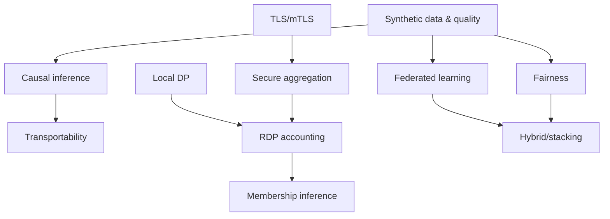

# Notebooks: Federated Insurance Learning, Privacy, Security, and Causality

## Overview
`notebooks/` contains 11 interactive notebooks covering synthetic data diagnostics, differential privacy, membership inference, secure aggregation concepts, federated learning evidence/simulation, fairness evaluation, hybrid modeling, causal inference, and transportability. Each notebook is intended to run top-to-bottom from the `notebooks/` directory (or repo root) using bundled project code in `src/insurance_fl/` and local artifacts in `data/`, `reports/`, `docs/`, and `artifacts/`.

## Scientific scope
- **Synthetic data & quality:** client distributions, correlation structure, cross-country utility, and empirical privacy-risk diagnostics (DCR/duplicates).
- **Privacy:** local DP mechanisms, RDP accounting for Gaussian events, restart-safe accounting state, and privacy-utility trade-offs.
- **Privacy attacks:** empirical black-box membership inference (MIA); results are not formal privacy guarantees.
- **Secure aggregation:** educational masking/threshold-sharing simulation and Flower `SecAggPlusWorkflow` parameter checks (not production cryptography).
- **Federated learning:** parsing committed Flower evidence logs and a labeled FedAvg reference simulation on bundled data.
- **Responsible AI:** per-country model performance metrics and disparity analysis with bootstrap uncertainty.
- **Ensemble/hybrid learning:** NN, boosters, NNLS stacking, and β-fusion with leakage-free splits.
- **Causal inference & transportability:** DAG-based adjustment/AIPW-style estimation, semi-synthetic truth validation, covariate-shift diagnostics, weighting, and transported ATEs.

## Notebook catalog

| Notebook | Domain | Techniques | Objectives | Difficulty | Runtime (light/full) | Execution status |
|---|---|---|---|---|---|---|
| `synthetic_data_generation.ipynb` | Synthetic data / EDA | Data quality, hist/ECDF, correlations, PCA/t-SNE, TSTR-style AUC matrix, DCR | Assess heterogeneity, utility transfer, and empirical leakage indicators | Intermediate | ~1–3 min / varies | Passed in light mode (this environment; see validation JSON) |
| `dp_accounting_rdp.ipynb` | Differential privacy | RDP, Gaussian mechanism, (ε,δ) conversion, state save/load, projections | Track/visualize cumulative ε and verify restart-safe accounting | Intermediate | <1 min / ~1–2 min | Passed in light mode |
| `local_dp.ipynb` | Local differential privacy | Randomized response, Laplace/Gaussian noise, RMSE/utility curves, `LocalDPConfig` | Understand LDP mechanisms and privacy-utility trade-offs | Intermediate | <1 min / ~1–2 min | Passed in light mode |
| `membership_inference.ipynb` | Privacy attacks | Black-box scores, ROC/PR, TPR@1%FPR, advantage, `insurance_fl.evaluation.mia` | Measure empirical membership leakage | Intermediate | ~1–2 min / varies | Passed in light mode |
| `security_secagg.ipynb` | Secure aggregation | Pairwise masking simulation, quantization, dropout, Shamir intuition, SecAgg+ params | Explain SecAgg goals, cancellation, and robustness concepts | Intermediate | <1 min / ~1 min | Passed in light mode |
| `fairness_evaluation.ipynb` | Responsible AI | Per-country metrics, disparity, bootstrap CI, ROC/calibration, threshold sweep | Compute and visualize fairness/performance disparities | Intermediate | ~1–2 min / varies | Passed in light mode |
| `flower_federated_learning.ipynb` | Federated learning | Log parsing, FedAvg reference sim, convergence/heterogeneity, comm cost | Interpret FL evidence and compare centralized/federated/local behavior | Intermediate | <1 min / ~2–5 min | Passed in light mode |
| `tls_credentials.ipynb` | Transport security | OpenSSL cert generation/verification, SAN/expiry inspection, mTLS/PKI diagrams | Generate and verify demo TLS/mTLS materials locally | Beginner–Intermediate | <1 min / <1 min | Passed in light mode |
| `hybrid_boosters_stacking.ipynb` | Ensemble learning | NN, boosters, OOF stacking (NNLS), β-fusion (`optimize_beta`), diagnostics | Compare and fuse models with leakage-free evaluation | Advanced | ~2–6 min / longer | Passed in light mode (ad hoc, sklearn fallbacks in light for stability) |
| `causal_inference_quickstart.ipynb` | Causal inference | DAG/adjustment, backdoor, AIPW-style DR, propensity/balance, CATE, sensitivity | Estimate and validate causal effects on injected semi-synthetic truth | Advanced | ~1–3 min / varies | Passed in light mode |
| `transportability_quickstart.ipynb` | Transportability | SMD/KS shift, domain classifier/weights, ESS, transported ATE, clipping sensitivity | Assess transport of effects/models to held-out countries | Advanced | ~1–3 min / varies | Passed in light mode |

> **Status note:** “Passed in light mode…” reflects notebooks executed successfully during modernization in this environment where indicated. Final authoritative status must come from `reports/notebook_validation.json` produced by `scripts/validate_notebooks.py` for a complete run.

## Learning pathways
- **Privacy engineering:** `local_dp.ipynb` → `dp_accounting_rdp.ipynb` → `membership_inference.ipynb`
- **Privacy attacks & defenses:** `membership_inference.ipynb` → `local_dp.ipynb` → `dp_accounting_rdp.ipynb`
- **Federated learning:** `flower_federated_learning.ipynb` → `fairness_evaluation.ipynb` → `hybrid_boosters_stacking.ipynb`
- **Secure FL:** `tls_credentials.ipynb` → `security_secagg.ipynb` → `dp_accounting_rdp.ipynb`
- **Responsible AI:** `synthetic_data_generation.ipynb` → `fairness_evaluation.ipynb` → `membership_inference.ipynb`
- **Causal inference:** `causal_inference_quickstart.ipynb` → `transportability_quickstart.ipynb`
- **Ensemble learning:** `synthetic_data_generation.ipynb` → `hybrid_boosters_stacking.ipynb`



## Prerequisites
- Python 3.11+ (project supports 3.11–3.13; environment used during modernization: 3.13).
- Repo dependencies installed (prefer editable install): `pip install -e .` or project-supported extras.
- Jupyter kernel (`ipykernel`) for notebook execution.
- Data present at `data/processed/european_insurance_federated/` for data-dependent notebooks.
- Optional tools/deps: `openssl` (TLS notebook), `dp-accounting` (DP accounting), `torch`/boosters (richer FL/hybrid demos), `pgmpy`/`networkx`/`statsmodels` (causal DAG/estimators/plots as available).

## Install
From repo root:
```bash
pip install -e ".[privacy]"
# dev/validation tools (if needed)
pip install -e ".[dev]"
# causal extras if using full project causal stack
pip install -e ".[causal]"
```
Notebook-specific commonly used packages (many already in base/dev envs): `matplotlib`, `seaborn`, `plotly`, `nbformat`, `nbclient`, `ipykernel`, `networkx`, `scikit-learn`, `scipy`, `pandas`, `numpy`. Install only what is missing; notebooks print clear skip messages for optional dependencies.

## How to run
From `notebooks/`:
```bash
cd notebooks
jupyter lab
```
Or execute programmatically from repo root:
```bash
NB_MODE=light python3 scripts/validate_notebooks.py
```
- `NB_MODE=light` (default): subsamples data and reduces iterations/bootstraps for faster runs.
- `NB_MODE=full`: uses larger samples/more iterations where implemented (slower).
- Notebooks resolve the repository root via `pyproject.toml` and add `src/` to `sys.path`; they do not rely on hardcoded machine paths.

## Dependency matrix (notebook × key packages)

| Notebook | Core (np/pd/sklearn/mpl) | Project modules | Optional / notable |
|---|---:|---|---|
| synthetic_data_generation | ✓ | `insurance_fl.data.quality` | seaborn/plotly optional styling not required; sklearn (PCA, t-SNE, LR) |
| dp_accounting_rdp | ✓ | `insurance_fl.fl.privacy` | `dp-accounting` (required for backend in project API) |
| local_dp | ✓ | `insurance_fl.fl.dp` | artifact `reports/dp_utility_curve.json` if present |
| membership_inference | ✓ | `insurance_fl.evaluation.mia` | `torch` (project feature demo), artifact `reports/mia_evaluation.json` |
| security_secagg | ✓ | — | `flwr` (`SecAggPlusWorkflow`), Mermaid-capable viewer |
| fairness_evaluation | ✓ | `insurance_fl.fl.fairness` | scipy/sklearn metrics |
| flower_federated_learning | ✓ | — | evidence logs in `docs/evidence/` |
| tls_credentials | ✓ | `generate_creds.py` (repo root) | `openssl`, `cryptography` |
| hybrid_boosters_stacking | ✓ | `insurance_fl.fl.stacking`, `insurance_fl.fl.hybrid`, `insurance_fl.fl.boosters` | `xgboost`, `lightgbm`, `catboost`, `torch`, `shap` not required |
| causal_inference_quickstart | ✓ | `insurance_fl.causal.truth`, `insurance_fl.causal.estimands/dag_check` (optional) | `statsmodels`, `networkx`, `pgmpy`, `pyyaml` |
| transportability_quickstart | ✓ | `insurance_fl.causal.truth` | `scipy`, `statsmodels`, sklearn |

## Data and artifact requirements
- **Bundled data:** `data/processed/european_insurance_federated/federated/<client>/{train,val,test}.parquet`
  - Generate if missing: `insurance-fl-generate --samples 5000 --output data/processed`
- **Evidence/logs:** `docs/evidence/layer1_flwr_run_2rounds.log`, `docs/evidence/layer2_flwr_run_3rounds.log`
- **Reports/artifacts (optional/precomputed):** `reports/dp_utility_curve.json`, `reports/mia_evaluation.json`, `artifacts/fairness_disparity.json`, `artifacts/secagg_run.log`
- **Causal config:** `docs/causal/dag.yaml`

## Visualization conventions
- Each figure includes title, axis labels (with units where applicable), legend for multi-series plots, and a Markdown interpretation cell (“How to read this / what it shows”).
- Figures are saved to `reports/figures/` via `nb.save_fig(...)` during execution.
- Multiple chart types per notebook (bars, lines, histograms/ECDFs, heatmaps, scatter/PCA, ROC/PR, box/error bars, diagrams/timelines as applicable).

## Reproducibility rules
- Shared seed (`nb.SEED`, default 42) and mode (`NB_MODE=light|full`) controlled in `notebooks/_nb_common.py`.
- No hidden state between notebooks; each runs top-to-bottom.
- No hardcoded machine paths; repository root discovered from `pyproject.toml`.
- Numbers shown should be computed in-notebook or loaded from a named artifact and labeled accordingly.

## Known limitations
- **Not formal guarantees:** MIA results, DCR checks, and educational SecAgg simulations are empirical/illustrative, not proofs of privacy or security.
- **Causal claims:** semi-synthetic injected truth validates estimator mechanics, not real-world causal effects; DAG/identification assumptions apply.
- **Transport assumptions:** conditional exchangeability, overlap/positivity, and correct modeling required; weights/ESS diagnostics are necessary but not sufficient.
- **Hybrid β caveat:** project `optimize_beta()` may use pooled/global holdout; this conflicts with strict federated no-raw-data-sharing in production (acceptable here for synthetic/demo contexts, or must be derived per-client).
- **Environment/runtime:** execution outcomes depend on installed dependencies, data availability, and kernel; see `reports/notebook_validation.json` for actual run status.

## Troubleshooting
- **Missing data directory:** run `insurance-fl-generate --samples 5000 --output data/processed`.
- **`dp-accounting` / privacy backend issues:** install privacy extras (`pip install -e ".[privacy]"`) and ensure `dp_accounting` imports.
- **`openssl` not found:** install OpenSSL (macOS: `brew install openssl`) and ensure it is on `PATH` for `tls_credentials.ipynb`.
- **Flower version/API mismatch:** project targets Flower 1.29.x behavior in places; verify `flwr.__version__` and adjust only if necessary.
- **Causal deps missing (`pgmpy`, etc.):** install `.[causal]` or rely on notebook fallbacks where provided.
- **Kernel/execution errors:** run with `NB_MODE=light`, confirm working directory is `notebooks/` or repo root, and inspect `reports/notebook_validation.json`.

## Contribution rules
- Keep all 11 notebook filenames and directory layout stable.
- Never fabricate results; label illustrative/precomputed content explicitly.
- Use `_nb_common.py` for paths, seeds, style, and figure saving.
- Import and reuse `src/insurance_fl/` APIs (check signatures) rather than duplicating logic.
- Do not hardcode machine-specific paths or `/tmp`; use `tempfile` where needed.
- Add new notebook dependencies to a justified extras group in `pyproject.toml` if required.
- Re-run validation and update `reports/notebook_validation.json` and README status columns from real results.
